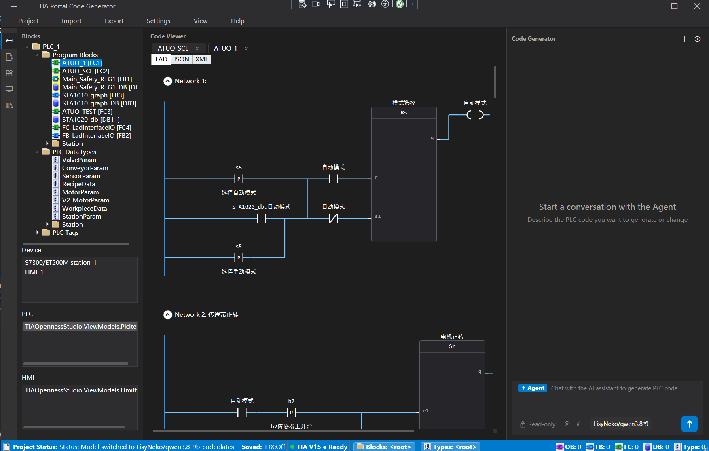
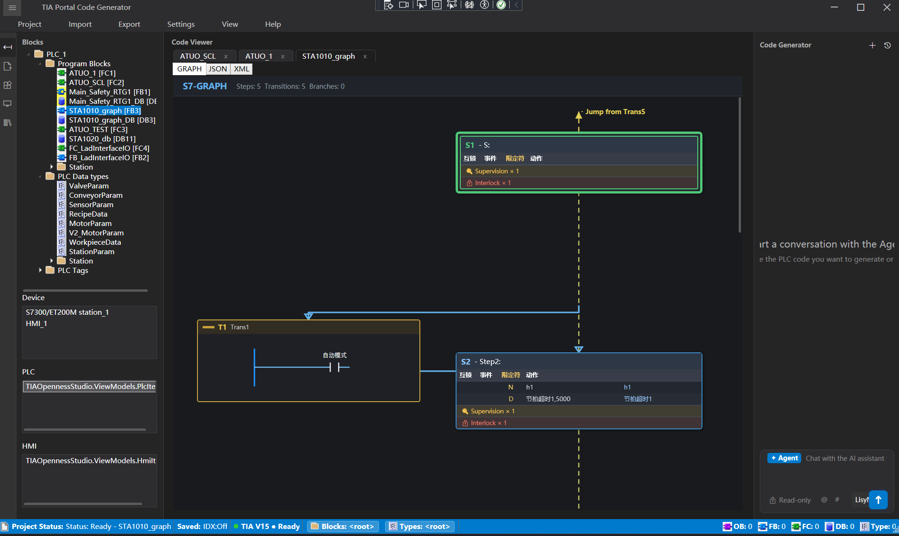

# TIA Openness Studio

面向 Siemens TIA Portal 的 AI 辅助工程自动化（WPF / .NET Framework 4.8）：把工程意图转化为 PLC 块生成与 schema 校验后的 XML，再经 Openness 导入并编译——以项目知识索引为依据，由本地工具面在实时工程上执行，任何写入都需人工审批。

## 免责声明

- 本项目**与 Siemens 无任何关联**，未获其背书或支持。
- `TIA Portal`、`STEP 7`、`WinCC`、`Openness` 均为 Siemens AG 的商标。
- **仓库不包含任何 Siemens 二进制文件。** 使用者必须自备有效的 TIA Portal 授权，并从自己的安装目录复制 `Siemens.Engineering.dll`。
- MIT 协议仅覆盖本仓库代码，不覆盖 Siemens 软件或第三方标准内容。

## 核心能力

- **项目与设备**：打开/保存/关闭/编译 TIA 项目，加载设备与 PLC 树。
- **块与类型**：导入 PLC Blocks / PLC Data Types，导出对象 XML，项目文本导入导出。
- **原生 PLC 生成**：离线构建 UDT、全局 DB、FC、FB、LAD（FlgNet）块，再经 Openness 导入。
- **AI 工作流**：聊天式 SCL/XML 生成、流式输出、项目索引辅助上下文检索。
- **离线 SCL 助手**：推荐本地模型 [`LisyNeko/qwen3.8-9b-coder`](https://ollama.com/LisyNeko/qwen3.8-9b-coder)——由 2.4 万亿参数（A95B）的 Qwen3.8 全参数蒸馏到 9B，并做编码向微调；离线写 SCL 表现突出，断网、无 API Key 也能用，适合内网或保密工程。
- **云端 Agent**：Python FastAPI + LangGraph supervisor，项目级 DAG 规划、逐块执行、里程碑审批与断点续跑。
- **知识索引 / RAG**：基于 SQLite 的块、网络、符号、调用图与交叉引用索引，经本地 MCP 端点提供给 Agent。
- **行业标准库（加密）**：公司或行业编码规范可打包为只读 `TKB1` 知识库（AES-256-CBC + HMAC-SHA256），经 `search_coding_standard` 工具提供给 Agent。
- **库备份与对比**：创建备份、查看历史、带安全副本的恢复、基于 Openness 的类型/主副本比较。
- **多语言**：English / Deutsch / 中文。

## 界面截图

左侧项目树 + LAD 代码视图 + 代码生成面板：



S7-GRAPH 步序视图，含步骤、转换与互锁标注：



## 架构

```
WPF UI（Prism + DryIoc）
  ├─ MainWindow（AI / Chat / Project / Tree / Graph / LibraryCompare 分域）
  ├─ ViewModels（MVVM）
  └─ Services
       ├─ OpennessService / TiaStaHost       所有 COM 访问固定在单一 STA 线程
       ├─ TiaContextHttpServer (:8001)       内建 MCP 工具面 + WriteGate 写审批
       ├─ Services/Builders                  PLC/HMI 离线 XML & JSON 构建器
       ├─ ProjectIndex / KnowledgeWorker     SQLite RAG 索引（TIAKnowledgeWorker.exe）
       └─ LibraryCompare                    备份 / 恢复 / 对比

Python 后端（TIAAgent/，FastAPI :8000）
  ├─ app/         路由、模型、SSE
  ├─ agent/       supervisor、planner、executor、plan store
  ├─ tools/       MCP 目录与适配层
  ├─ core/        提示词
  └─ converters/  数据转换
```

- 内建 MCP 服务（`127.0.0.1:8001`）是唯一面向 Openness 的工具面，Python Agent 不直接访问 COM。
- 所有 Openness COM 调用都跑在独立 STA 线程（`TiaStaHost`）上；不要在 COM 对象外使用 `Task.Run` 或 `Dispatcher.InvokeAsync`。
- 写操作由 `WriteGate` 拦截，用户在聊天抽屉中批卡后才会真正写入 TIA。

完整分层、Agent 路径、工具面、RAG 表结构、标准库打包与版本矩阵见 [技术方案设计](docs/TECHNICAL_DESIGN-CN.md)。

## 知识索引（RAG）

Agent 不直接读取 TIA 工程：独立的 `TIAKnowledgeWorker.exe` 把工程事实抽取到本地 SQLite 索引，再由内建 MCP 服务（`127.0.0.1:8001`）暴露查询工具。

- **索引对象**：目录/分组、PLC 块、LAD/SCL 网络、接口成员、符号交叉引用、块调用图、块快照、规划经验、修复经验与脏块跟踪。
- **缓存位置**：`%LOCALAPPDATA%\TIAOpennessStudio\KnowledgeCache`。
- **数据字典**：[`docs/schema/RAG数据表结构说明.md`](docs/schema/RAG数据表结构说明.md) 逐表说明字段；改表结构时必须同步更新该文档。

## 行业标准库（加密）

公司或行业编码规范可以打包成只读 `standards.kb`，在运行时挂载：

- **容器格式**：`TKB1` 头 + AES-256-CBC 密文 + HMAC-SHA256 校验；密钥由 PBKDF2-SHA256（12 万次迭代）从外部注入的 secret salt（`TIA_STD_KB_SECRET`）派生，可选绑定机器指纹，复制到其他机器后无法解密。
- **访问模型**：先校验 HMAC，再在内存解密，落到临时只读 SQLite 库使用后即删除；只提供检索、不支持导出，并带频率限制与结果条数上限。
- **Agent 接口**：`search_coding_standard` 返回规则片段，重写为约束指令后注入生成提示词，使生成的 SCL/LAD 遵循挂载标准。
- **打包工具**：`StandardsKbTool build <md 目录或文件> <输出.kb>` 把明文 Markdown 规范加密成 `.kb`，`verify` 可验证加密/解密闭环；仓库只分发加密文件，明文源与 `*.secret` 不入库。

## 变更预览与 Diff

AI 生成的内容不会直接写入工程：

- 生成或修改后的代码先进入 **Diff 页签**（基于 DiffPlex），支持并排/统一两种视图与逐行变更着色。
- 用户必须点 **应用** 或 **拒绝**；这是独立的人工确认点；经 MCP 工具发起的写入还会再经过 `WriteGate` 审批。
- **库对比** 生成供人阅读的 XML 报告，不是可导入 TIA 的工程产物。

## 环境要求

- Windows x64
- .NET Framework 4.8 运行时（使用 .NET SDK / MSBuild 构建）
- 已安装 TIA Portal 与 Openness
  - 已支持：V15.1、V16、V17。V15.1 为参考基线；V16/V17 的 schema 已与官方 XSD 对齐。
  - V18–V21 档位为实验性：按命名规律推导，尚未经 XSD/样例验证。
- Python 3.11（云端 Agent 后端，可使用仓库附带的嵌入式解释器）

## 快速开始

### 1. 克隆并准备 Openness DLL

```powershell
git clone <your-fork-url> TIAOpennessStudio
cd TIAOpennessStudio
```

从自己的 TIA 安装目录复制 `Siemens.Engineering.dll` 到 `TIAOpennessStudio\`：

```powershell
# 以 V15.1 为例，请按实际安装路径调整
Copy-Item "C:\Program Files\Siemens\Automation\Portal V15_1\PublicAPI\V15.1\Siemens.Engineering.dll" `
          ".\TIAOpennessStudio\Siemens.Engineering.dll"
```

`TIAOpennessStudio.csproj` 通过 `HintPath` 引用该文件，缺失时会构建失败。该 DLL 已被 git 忽略，**绝不能提交**。

### 2. 构建

```powershell
dotnet build .\TIAOpennessStudio.sln
```

`TIAKnowledgeWorker.csproj` 以源码链接方式编译主程序的部分文件，因此务必构建整个解决方案，确保 `TIAOpennessStudio.exe` 与 `TIAKnowledgeWorker.exe` 同步更新。

若应用正在运行并锁住 exe（`MSB3021` / `MSB3027`），关闭应用或加 `-p:UseAppHost=false`。

### 3. 启动 Python 后端（可选，用于云端 AI）

```powershell
cd TIAAgent
python -m pip install -r requirements.txt
python run.py --port 8000
```

C# 端默认连接 `http://127.0.0.1:8000`；内建 MCP/上下文服务监听 `127.0.0.1:8001`，随应用自动启动。

### 4. 配置 AI 提供方

创建 `%APPDATA%\TIAOpennessStudio\ai_config.json`：

```json
{
  "Endpoint": "https://your-provider/v1",
  "Model": "your-model",
  "ApiKey": "sk-...",
  "LocalBackendUrl": "http://127.0.0.1:8000"
}
```

该文件已被 git 忽略，切勿提交。

### 5. 可选：本地模型（Ollama）

应用可以通过 Ollama 运行本地模型；只用云端模型的话可以跳过这一步。

1. 运行仓库内的下载脚本，把免安装运行时（约 1.6 GB）拉到本目录：

   ```powershell
   powershell -ExecutionPolicy Bypass -File .\TIAOpennessStudio\Tools\Ollama\download-ollama.ps1
   ```

   完成后会得到 `TIAOpennessStudio\Tools\Ollama\ollama.exe`；该运行时已被 git 忽略，不会上传。
   也可以直接从 <https://ollama.com/download> 安装；若装在 `%LOCALAPPDATA%\Programs\Ollama\`
   或 `ollama.exe` 已在 `PATH`，应用会优先使用那里，无需再放进 `Tools\Ollama\`。
2. 拉取推荐模型（`ollama pull LisyNeko/qwen3.8-9b-coder`，6.7 GB，256K 上下文）；已安装的模型会自动出现在模型选择器中。
3. 启动应用；若 `127.0.0.1:11434` 没有服务在监听，应用会自动执行 `ollama serve`。

模型权重存放在 Ollama 自己的模型目录（默认 `%USERPROFILE%\.ollama\models`），
无论 `ollama.exe` 放在哪里，都不会进入本仓库。

## 测试

```powershell
cd TIAAgent
python -m pytest tests -q
```

当前测试仅覆盖 plan 模型的序列化、持久化与拓扑排序（33 个用例，`tests/test_plan_models.py`）。C# 侧暂无单元测试工程。

## 参与贡献

当前最需要帮助的方向：

1. **版本验证**：在 V18 / V19 / V20 / V21 上校验生成 XML，补强 V16 / V17 的导入验证，并同步更新 schema 档位。
2. **集成测试**：规划 → 生成 → 编译 → 写入的端到端链路，以及失败路径覆盖。
3. **HMI 写回**：把离线 HMI 构建器扩展为 Openness 写入器。

请保持改动聚焦、尽量补测试，并避免提交 Siemens 二进制、客户工程数据或标准库内容。

## 许可证

MIT — 见 [LICENSE](LICENSE)。

## 商业支持与官方构建

源码将始终保持 MIT 免费。计划提供"预编译、已验版本"的官方构建包与优先支持，作为付费选项，用于补贴 TIA 版本测试与硬件成本；付费不会削减开源版的任何功能。

联系方式：扫描下方微信二维码添加维护者。注意个人「添加我为朋友」二维码约 7 天失效，
若已过期请提 Issue，我们会更新。


