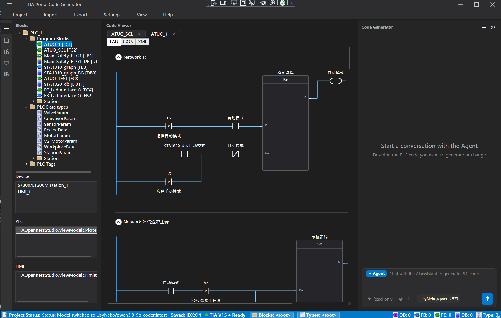
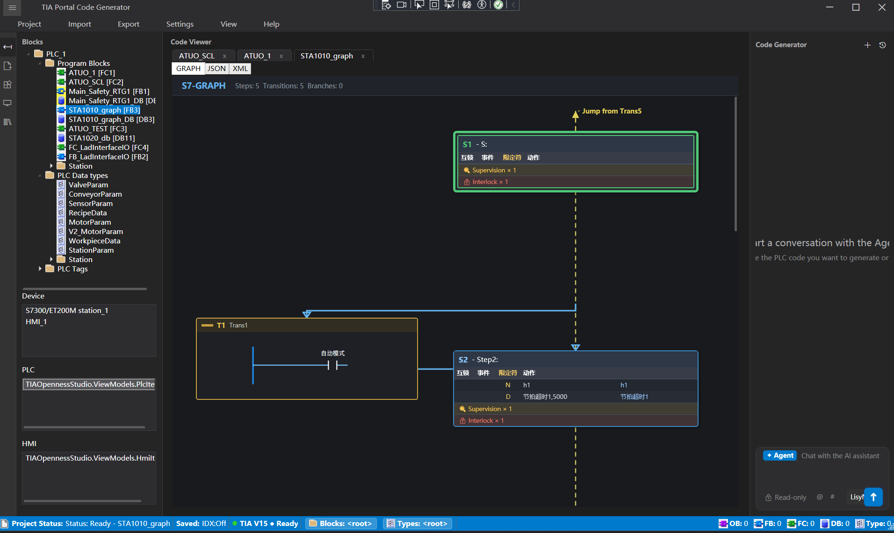
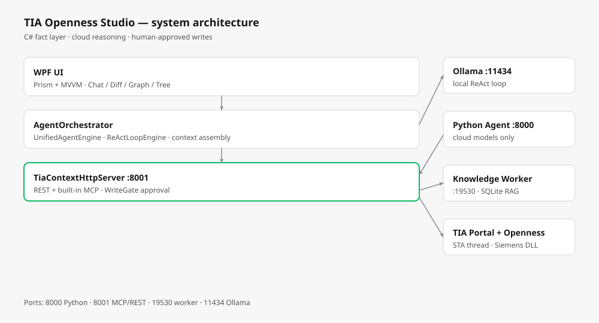

# TIA Openness Studio

AI-assisted engineering automation for Siemens TIA Portal (WPF / .NET Framework 4.8): engineering intent becomes generated PLC blocks and schema-checked XML that are imported and compiled through Openness — grounded in a project knowledge index, executed against the live project by a local tool surface, and gated by human approval before any write.

## Disclaimer

- This project is **not affiliated with, endorsed by, or supported by Siemens**.
- `TIA Portal`, `STEP 7`, `WinCC` and `Openness` are trademarks of Siemens AG.
- **No Siemens binaries are distributed in this repository.** You must own a valid TIA Portal license and copy `Siemens.Engineering.dll` from your own installation.
- The MIT license covers only the code in this repository, not Siemens software or third-party standards content.

## Features

- **Project & device operations** — open / save / close / compile TIA projects, load device and PLC trees.
- **Block & type workflows** — import PLC Blocks and PLC Data Types, export objects as XML, import/export project texts.
- **Native PLC generation** — offline builders for UDT, global DB, FC, FB and LAD (FlgNet) blocks, then Openness import.
- **AI workflow** — chat-style SCL/XML generation, streaming output, project-index-assisted context retrieval.
- **Offline SCL assistant** — the recommended local model is [`LisyNeko/qwen3.8-9b-coder`](https://ollama.com/LisyNeko/qwen3.8-9b-coder), a 9B coder model distilled from the 2.4T-parameter Qwen3.8-A95B and fine-tuned for coding. It writes SCL without network access or an API key, which suits air-gapped or privacy-sensitive projects.
- **Cloud agent** — Python FastAPI + LangGraph supervisor, project-level DAG planning, per-block execution, milestone approval and resume.
- **Knowledge index / RAG** — SQLite-backed block, network, symbol, call-graph and cross-reference index, served to the agent over a local MCP endpoint.
- **Encrypted standards library** — company or industry coding rules packaged as a read-only `TKB1` knowledge base (AES-256-CBC + HMAC-SHA256), exposed to the agent through the `search_coding_standard` tool.
- **Library backup & compare** — create backups, inspect history, restore with a safety copy, and compare types/master copies via Openness.
- **Localization** — English / German / Chinese.

## Screenshots

Project tree with the LAD code view and the code-generator panel:



S7-GRAPH network with steps, transitions and interlock annotations:



## Architecture

```
WPF UI (Prism + DryIoc)
  ├─ MainWindow (AI / Chat / Project / Tree / Graph / LibraryCompare partials)
  ├─ ViewModels (MVVM)
  └─ Services
       ├─ OpennessService / TiaStaHost       COM access pinned to one STA thread
       ├─ TiaContextHttpServer (:8001)       built-in MCP tool surface + WriteGate approvals
       ├─ Services/Builders                  offline PLC/HMI XML & JSON builders
       ├─ ProjectIndex / KnowledgeWorker     SQLite RAG index (TIAKnowledgeWorker.exe)
       └─ LibraryCompare                     backup / restore / compare

Python backend (TIAAgent/, FastAPI :8000)
  ├─ app/         routes, models, SSE
  ├─ agent/       supervisor, planner, executor, plan store
  ├─ tools/       MCP catalog and adapters
  ├─ core/        prompts
  └─ converters/  data conversion
```



- The built-in MCP server on `127.0.0.1:8001` is the only tool surface for Openness operations. The Python agent never touches COM directly.
- All Openness COM access runs on a dedicated STA thread (`TiaStaHost`). Do not add `Task.Run` or `Dispatcher.InvokeAsync` around COM objects.
- Writeshaping tools are gated by `WriteGate`; the user approves writes in the chat drawer before they reach TIA.

For the full layering, agent paths, tool surface, RAG schema, standards packaging and version matrix, see [Technical design](docs/TECHNICAL_DESIGN.md).

## Knowledge index (RAG)

The agent never reads TIA Portal directly. A separate `TIAKnowledgeWorker.exe` extracts project facts into a local SQLite index, and the built-in MCP server (`127.0.0.1:8001`) exposes query tools over that index.

- **Indexed entities** — containers, PLC blocks, LAD/SCL networks, interface members, symbol cross-references, block call graph, block snapshots, planning knowledge, repair experience and dirty-block tracking.
- **Cache location** — `%LOCALAPPDATA%\TIAOpennessStudio\KnowledgeCache`.
- **Data dictionary** — [`docs/schema/RAG数据表结构说明.md`](docs/schema/RAG数据表结构说明.md) documents every table and column; keep it in sync when the schema changes.

## Encrypted standards library

Company or industry coding standards can be packaged into a read-only `standards.kb` and mounted at runtime:

- **Container** — `TKB1` header, AES-256-CBC ciphertext and an HMAC-SHA256 tag. Keys are derived with PBKDF2-SHA256 (120,000 iterations) from an externally supplied secret salt (`TIA_STD_KB_SECRET`); optional machine binding makes a copied file undecryptable elsewhere.
- **Access model** — the file is HMAC-verified, decrypted in memory, queried through a temporary read-only SQLite database and removed after use. Search only, no export, with rate limiting and a capped result set.
- **Agent surface** — `search_coding_standard` returns rule snippets that are rewritten as constraint directives and injected into the generation prompt, so generated SCL/LAD follows the mounted standard.
- **Packaging** — `StandardsKbTool build <md-dir|file> <out.kb>` turns plaintext Markdown standards into an encrypted `.kb`; `StandardsKbTool verify` proves the round trip. Only the encrypted file is distributable — plaintext sources and `*.secret` stay out of git.

## Change preview and diff

Nothing generated by AI is written straight into the project:

- Generated or edited code is first shown in a **Diff tab** built on DiffPlex, with side-by-side and unified views and per-line change coloring.
- The user must press **Apply** or **Reject**; this is an independent confirmation point, and writes issued through MCP tools additionally pass through `WriteGate` approval.
- **Library compare** produces an XML report for humans; it is not a TIA-importable artifact.

## Requirements

- Windows x64
- .NET Framework 4.8 runtime (build with .NET SDK / MSBuild)
- TIA Portal with Openness installed
  - Supported: V15.1, V16 and V17. V15.1 is the reference baseline; V16/V17 schemas are aligned with the official XSD.
  - V18–V21 profiles are experimental: derived from the naming pattern, with no XSD or sample verification yet.
- Python 3.11 for the cloud-agent backend (the repo also supports an embedded interpreter)

## Getting started

### 1. Clone and provide the Openness DLL

```powershell
git clone <your-fork-url> TIAOpennessStudio
cd TIAOpennessStudio
```

Copy `Siemens.Engineering.dll` from your own TIA installation's `PublicAPI` folder into `TIAOpennessStudio\`:

```powershell
# Example for V15.1 — adjust the path to your installation
Copy-Item "C:\Program Files\Siemens\Automation\Portal V15_1\PublicAPI\V15.1\Siemens.Engineering.dll" `
          ".\TIAOpennessStudio\Siemens.Engineering.dll"
```

`TIAOpennessStudio.csproj` references this file via `HintPath`, so a build fails until it is present. The DLL is git-ignored and must never be committed.

### 2. Build

```powershell
dotnet build .\TIAOpennessStudio.sln
```

`TIAKnowledgeWorker.csproj` compiles several main-program source files directly (source-level link). Always build the solution so both `TIAOpennessStudio.exe` and `TIAKnowledgeWorker.exe` are up to date.

If the app is running and locks the executable (`MSB3021` / `MSB3027`), close it or add `-p:UseAppHost=false`.

### 3. Start the Python backend (optional, for cloud AI)

```powershell
cd TIAAgent
python -m pip install -r requirements.txt
python run.py --port 8000
```

The C# app defaults to `http://127.0.0.1:8000`. The built-in MCP/context service listens on `127.0.0.1:8001` and starts automatically with the app.

### 4. Configure the AI provider

Create `%APPDATA%\TIAOpennessStudio\ai_config.json`:

```json
{
  "Endpoint": "https://your-provider/v1",
  "Model": "your-model",
  "ApiKey": "sk-...",
  "LocalBackendUrl": "http://127.0.0.1:8000"
}
```

Never commit this file. It is git-ignored.

### 5. Optional: local LLM (Ollama)

The app can serve a local model through Ollama. Cloud providers work without this step.

1. Run the helper script, which downloads the standalone runtime (~1.6 GB) into this folder:

   ```powershell
   powershell -ExecutionPolicy Bypass -File .\TIAOpennessStudio\Tools\Ollama\download-ollama.ps1
   ```

   Result: `TIAOpennessStudio\Tools\Ollama\ollama.exe`. The runtime is git-ignored and never uploaded.
   Alternatively install Ollama from <https://ollama.com/download>; if it lands in
   `%LOCALAPPDATA%\Programs\Ollama\` or `ollama.exe` is on `PATH`, the app uses that install instead.
2. Pull the recommended model (`ollama pull LisyNeko/qwen3.8-9b-coder`, 6.7 GB, 256K context). Installed models are listed automatically in the model picker.
3. Start the app; if nothing is listening on `127.0.0.1:11434` it launches `ollama serve` itself.

Model weights are stored in Ollama's own model directory (default `%USERPROFILE%\.ollama\models`),
so they stay outside this repository regardless of where `ollama.exe` lives.

## Tests

```powershell
cd TIAAgent
python -m pytest tests -q
```

Current coverage is limited to plan-model serialization, persistence and topology (33 tests, `tests/test_plan_models.py`). There is no C# unit-test project yet.

## Contributing

The most valuable contributions right now:

1. **Version verification** — validate the generated XML against V18 / V19 / V20 / V21, deepen import coverage for V16 / V17, and update the schema profiles.
2. **Integration tests** — end-to-end plan → generate → compile → write, and failure-path coverage.
3. **HMI write-back** — turn the offline HMI builders into Openness writers.

Please keep changes focused, add tests where practical, and avoid committing Siemens binaries, customer project data or standard-library content.

## License

MIT — see [LICENSE](LICENSE).

## Commercial support and official builds

The source is and will remain free under MIT. Prebuilt, version-verified packages and priority support are planned as a paid option to fund TIA version testing and hardware; they do not remove any functionality from the open-source build.

Contact: scan the WeChat QR code below to reach the maintainer. A personal
"add me as friend" code expires after about 7 days; if it no longer works, open an issue
and we will refresh it.


