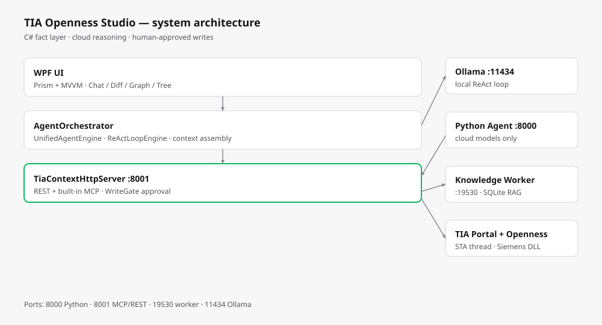
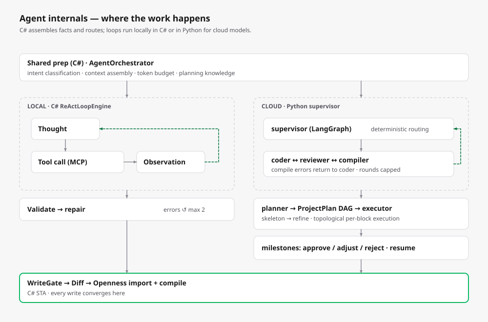
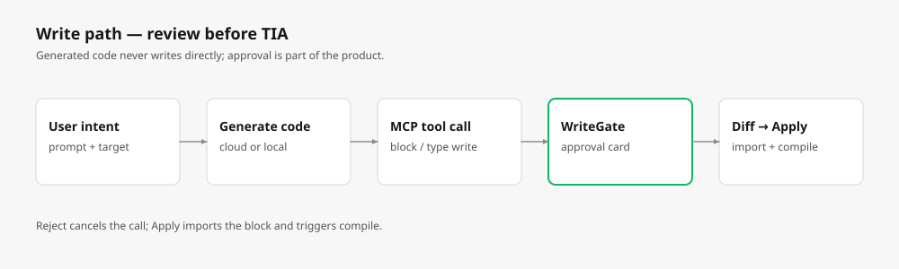
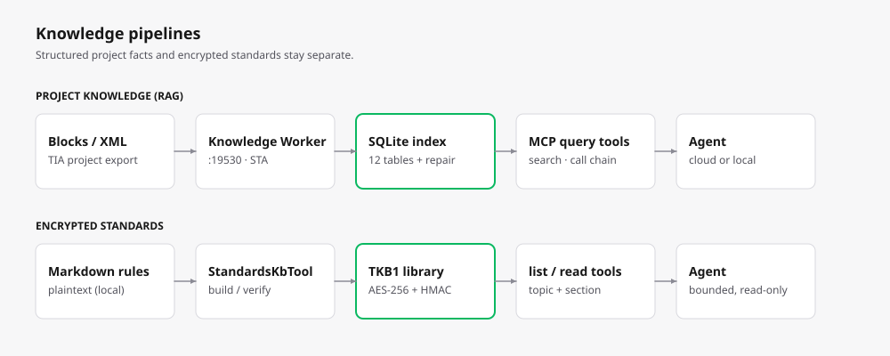

# 技术方案设计

> 与 v1.36.0（2026-11）代码对齐。以代码为准，本文说明各模块如何协作。

## 1. 设计原则

- **C# 是事实层，Python 是推理层**：依赖、调用链、符号引用等事实由 C# 静态抽取；LLM 只做检索增强与解释，不臆测工程结构。
- **双路径 Agent，互不回退**：云端模型走 Python（LangGraph），本地 Ollama 模型走 C# `ReActLoopEngine`；Python 后端只服务云端，并对本地端点 fail-closed。
- **STA 亲和**：所有 Openness COM 调用都在专用 STA 线程执行，WPF UI 线程不接触 COM。
- **进程隔离**：TIA attach、索引与缓存维护放在 `TIAKnowledgeWorker.exe`，降低 UI 卡顿并隔离 TIA 运行时。
- **写入前人工确认**：块写入经 `WriteGate` 审批；AI 生成内容先在 Diff 页签预览，再决定应用。

## 2. 解决方案结构

| 工程 | 目标框架 | 职责 |
|---|---|---|
| `TIAOpennessStudio.csproj` | net48 | 主 WPF 应用 |
| `TIAOpennessStudio.V21.csproj` | net48（`TIA_V21`） | V21 构建变体，启用 in-process Portal 桥接 |
| `TIAKnowledgeWorker.csproj` | net48 / x64 | 知识缓存 Worker 子进程 |
| `StandardsKbTool.csproj` | net48 | 加密标准库打包/校验 CLI |
| `TIAAgent/` | Python 3.11 | FastAPI + LangGraph 后端（仅云端模型） |

## 3. 架构分层

```
WPF UI（Prism + DryIoc）
  ├─ MainWindow 分域 / Controls / Dialogs
  ├─ ViewModels（MVVM + EventAggregator）
  ├─ C# 路由层：AgentOrchestrator → UnifiedAgentEngine / ChatRequestRouter
  ├─ 工具层：ToolRegistry / OpennessService / Portal.*（90+ Openness 操作）
  ├─ TiaContextHttpServer :8001（REST + 内置 MCP Server，JSON-RPC 2.0）
  ├─ 知识基础设施：依赖索引 / RAG / 规划知识 / Worker 代理
  └─ 外部依赖：Siemens.Engineering.dll / TIA Portal / OPC UA / LLM API

Python 后端 :8000（仅云端）
  ├─ app/main.py        REST + SSE 端点
  ├─ agent/supervisor   LangGraph StateGraph，coder / reviewer / chat
  ├─ agent/planner      项目级 DAG 规划
  ├─ agent/executor     逐任务执行与逐块编译
  └─ core/context       Token 预算、历史压缩、流解析
```



## 4. Agent 执行



### 4.1 C# 路由

`AgentOrchestrator` 完成意图识别、上下文组装、规划知识召回与压缩后分流：

- **本地模型（Ollama）** → `ReActLoopEngine`，请求绝不进入 Python。
- **云端模型** → `UnifiedAgentEngine`，向 Python 后端转发 SSE（`/generate_stream`，可选 `/chat_plan`）。该路径 C# 侧不解析、不执行工具。
- **Legacy 路径** → 静态计划构建 + 执行。

### 4.2 Python Agent（云端）

- `supervisor` 使用 LangGraph `StateGraph`；确定性路由器限制 coder↔reviewer 轮次与编译重试次数，审查不通过绝不伪造 PASS。
- `planner` 把项目级需求拆成任务 DAG；`executor` 按拓扑序执行，并在每个块生成后立即编译。
- 长任务持久化到 SQLite（`plan_store`），通过后台 job（`plan_job`）运行，SSE 断连不影响执行。
- 里程碑审批（`/plan/decide`）与任务失败决策（`/plan/task_decide`）是显式端点。

主要端点：`/generate`、`/generate_stream`、`/chat_plan`、`/plan/run`、`/plan/decide`、`/plan/task_decide`、`/plan/{id}`、`/plan/{id}/stream`、`/convert_xml`、`/validate`、`/health`。

### 4.3 本地 Agent（C#）

`ReActLoopEngine` 在进程内实现 ReAct 循环，调用 `127.0.0.1:11434` 上的 Ollama，并与云端共享同一套工具注册表。这是"断网、无 API Key 也能写 SCL"的实现基础。

## 5. Openness 集成

- **主进程 STA**：`TiaStaHost` 运行专用后台 STA 线程 + WPF 消息泵，所有 Openness 调用 marshal 到此线程。
- **Worker STA**：`TiaStaExecutor` 在 `TIAKnowledgeWorker.exe` 内提供同等保证。
- **导出守卫**：`ExportBlockXmlAsync` / `ExportTypeCodeAsync` 在 `Export()` 前检查 `block.IsConsistent` 与 `IsKnowHowProtected`；不一致或受保护的块直接跳过，避免拖死 STA 线程。
- **版本适配**：`ITiaVersionAdapter` / `TiaApiPathResolver` 探测已安装 TIA 版本并解析对应 `Siemens.Engineering.dll`；schema 档位来自 `LadSchemaRegistry`。

## 6. 工具面

`TiaContextHttpServer` 监听 `127.0.0.1:8001`，对外有两种入口：

- **REST**：供 Python Agent 调用的只读上下文、知识工具、编译/校验、导入/删除。
- **MCP（JSON-RPC 2.0）**：40+ 工具，以运行中的 `tools/list` 为准（撰写时为 42 个定义）。

工具族包括：块/类型读写、编译、项目与标签查询、知识检索、HMI 构建、`reflect_generation`（SIMATIC ML 形状对比）、标准库浏览、硬件组态。

知识类工具（`search_project`、`build_context_pack`、`query_variable_references`、`query_call_chain`、`query_variable_impact`、`describe_knowledge_schema`）共用内部方法 `InvokeKnowledgeToolAsync`，REST 与 MCP 不会出现两套实现漂移。

**WriteGate** 对写入类工具分级；用户在审批卡上看到块名、类型、分组路径与内容哈希后，才会真正写入 TIA。



### 新增工具的步骤

1. 在 `_mcpToolDefinitions` 声明工具；
2. 在派发 switch 中只加一行 `case`；
3. 实现放进独立 partial 文件（如 `TiaContextHttpServer.Builders.cs`）；
4. 同步登记到 Python catalog（`TIAAgent/tools/catalog.py`），否则 `invoke_tool` 会拒绝。

## 7. 知识索引（RAG）

- `TIAKnowledgeWorker.exe` 负责工程索引，通过本地 HTTP（默认 `127.0.0.1:19530`，Bearer Token）提供；主进程经 `ProjectKnowledgeWorkerHostService` 代理。
- 缓存位于 `%LOCALAPPDATA%\TIAOpennessStudio\KnowledgeCache`。
- 索引是结构化 SQLite，不是向量检索；规范操作数路径（如 `DB_Main.Line01.RunCmd`）是引用与影响查询的主键。
- 已登记表：`plc_container`、`plc_block`、`plc_network_lad`、`plc_network_scl`、`plc_interface_member`、`plc_symbol_ref`、`plc_call_edge`、`project_index_state`、`planning_knowledge`、`project_cache_state`、`project_dirty_entry`、`plc_block_snapshot`，另有 `repair_experience`。
- 数据字典见 `docs/schema/RAG数据表结构说明.md`；修改任何 `CREATE TABLE` 必须同步更新 `KnowledgeSchemaDoc.cs` 与该文档。
- 规划知识属于"建议"：历史成功计划作为独立字段 `planning_knowledge` 传入，不混入工程事实。



## 8. 加密标准库

- 容器 `TKB1`：4 字节魔数 + 16 字节 IV + 32 字节 HMAC + AES-256-CBC 密文。
- 密钥由 PBKDF2-SHA256（12 万次迭代）从外部 secret salt（`TIA_STD_KB_SECRET`）派生，可选并入机器指纹。
- 运行时先验 HMAC，再在内存解密，落到临时只读 SQLite，用完即删；仅支持检索/阅读，带频率限制与结果上限。
- 密钥来源：官方内置盐（自动解密）、用户口令（DPAPI 保存）、明文（仅开发用）。
- Agent 接入：MCP 暴露 `list_standard_topics` / `read_standard_section` 供自主浏览；本地 C# Agent 使用 `search_coding_standard`。
- 打包：`StandardsKbTool build <md 目录|文件> <输出.kb>`；`verify` 验证加解密闭环。

## 9. Diff 与写回

- `DiffPreviewControl` 基于 DiffPlex，提供并排、统一、编辑三种视图，行级高亮与同步滚动。
- 所有生成或回退内容先预览，由用户点 **应用** 或 **拒绝**。
- `PatchService` 生成 unified diff、按 manifest 批量原子写入，失败回滚。
- 块写入最终经 `OpennessService.ImportBlockCodeAsync` 落到 TIA，分组路径按需自动创建。

## 10. 上下文与 Token 预算

- C# `TokenBudget` 按模型家族为本地循环分配预算；未知本地模型使用小预算兜底。
- Python `core/context.py` 只服务云端：优先使用 C# 传入的真实 `context_window`，否则回退到 128k。
- 两侧都保留响应预留，并在窗口溢出前压缩历史；system 摘要独立于滑窗保留。

## 11. 版本矩阵

| TIA 版本 | Schema 状态 | 说明 |
|---|---|---|
| V15.1 | 参考基线 | 命名空间由 `docs/samples/V15.1` 的真实导出确认 |
| V16 | 与官方 XSD 对齐 | Interface v4 / FlgNet v4 / SCL v3 |
| V17 | 与官方 XSD 对齐 | LAD XSD 与 V16 字节一致 |
| V18–V21 | 实验性 | 按命名规律推导，尚未经 XSD/样例验证 |

`TIAOpennessStudio.V21.csproj` 另提供实验性的 in-process Portal 桥接（`TIA_V21`）。

## 12. 端口

| 端口 | 服务 |
|---|---|
| 8000 | Python FastAPI 后端 |
| 8001 | TIA 上下文 REST + 内置 MCP Server |
| 19530 | 知识 Worker（默认） |
| 11434 | Ollama |

## 13. 构建与测试

```powershell
dotnet build .\TIAOpennessStudio.sln

cd TIAAgent
.\python\python.exe -m pytest tests -q
```

构建前必须从自己的 TIA 安装目录复制 `Siemens.Engineering.dll`，该文件永不入库。
